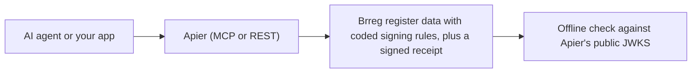

# apier-python: Python client for Apier, Norwegian company verification and signing authority from Brreg

[](https://github.com/apier-no/apier-python/actions/workflows/ci.yml)
[](LICENSE)

[Apier](https://apier.no) gives AI agents machine-verifiable Norwegian company authority. For a 9-digit organisasjonsnummer it returns company verification (registration status, bankruptcy and liquidation flags, VAT registration, registered roles such as daglig leder and the board) and the company's signing authority, signaturrett and prokura, as Brønnøysundregistrene (Brreg) hold it in Enhetsregisteret and Fullmakttjenesten. Each answer carries its source and retrieval time, and you can ask for a signed receipt. It is used in KYB flows where an agent onboards, pays or contracts with a Norwegian company, over REST or MCP.

This repository is the Python client: one class, `Client`, with one method, `get`.

- **Zero runtime dependencies.** Pure Python stdlib (`urllib`, `ssl`, `json`).
- **HTTPS-only**, with defence-in-depth against open redirects.
- **Typed** (`py.typed`), `mypy --strict` clean.
- Python 3.11+.

## Try it in 30 seconds (no key)

The public sandbox answers for the test company `999999999` without a key or an account:

```bash
curl -s https://www.apier.no/api/v1/sandbox/public/company/999999999/authority
```

Response from 2026-11-25, trimmed (other fields omitted):

```json
{
  "success": true,
  "data": {
    "org_number": "999999999",
    "name": "Apier Public Sandbox AS",
    "entity_type": "AS",
    "classification": "sole",
    "summary": "Én rolle kan signere alene for selskapet.",
    "combinations": [
      {
        "kombinasjons_id": "SANDBOX-KOMB-DAGL-ALENE",
        "description": "Daglig leder signerer alene.",
        "role_codes": ["DAGL"]
      }
    ],
    "signaturrett_holders": [{ "role": "DAGL", "name": "Ola Nordmann" }],
    "prokura_holders": [],
    "source": "brreg.fullmakt",
    "rule_set": "no.brreg.signatur.v1"
  },
  "_meta": { "is_sandbox": true, "source": "apier.no" }
}
```

Sandbox data is fictional. The public sandbox allows 100 requests per hour per IP address.

## How it fits together



## Install

The package is not on PyPI yet. Install it from this repository:

```bash
pip install "git+https://github.com/apier-no/apier-python.git"
```

The distribution is named `apier-no` and the import name is `apier`. The package named `apier` on PyPI is an unrelated third-party package; do not install it.

## Usage

### Verify and Authority, no key

```python
from apier import Client

client = Client()

verify = client.get("/api/v1/sandbox/public/company/999999999/verify")
print(verify["data"]["verification_status"])      # "pass"

authority = client.get("/api/v1/sandbox/public/company/999999999/authority")
print(authority["data"]["classification"])        # "sole"
print(authority["data"]["combinations"])
```

### Proof, sandbox bearer

Adding `?certificate=true` wraps the answer in a certificate with a detached JWS signature. The public sandbox does not sign. The bearer sandbox does, with a bearer you invent yourself and no signup:

```python
import uuid
from apier import Client

client = Client(api_key=f"apier_sandbox_test_{uuid.uuid4().hex}")
cert = client.get("/api/v1/sandbox/company/818000006/authority?certificate=true")
print(cert["data"]["kid"])          # "apier-sandbox-cert-1"
print(cert["data"]["signature"])    # detached JWS: <header>..<signature>
```

A sandbox certificate is signed with a key that is public on purpose (`https://www.apier.no/.well-known/sandbox-jwks.json`), so it proves nothing about Apier. Use it to rehearse verification code. How to verify a certificate offline: https://www.apier.no/docs/guides/verify-certificate

### Production, with a key

```python
from apier import Client

client = Client(api_key="apr_free_<your_key_here>")   # or set APIER_API_KEY
authority = client.get("/api/v1/company/<org_number>/authority")
```

Replace `<org_number>` with a real organisasjonsnummer; `999999999` exists only in the sandbox. Production calls need a key and are charged per call; see the [pricing page](https://www.apier.no/pricing). https://www.apier.no/docs/authentication explains how to get a key.

### Errors

Errors normalise to a structured `ApierError`:

```python
from apier import ApierError, Client

try:
    Client().get("/api/v1/company/999999999/authority")   # production path without a key
except ApierError as e:
    print(e.status)                  # 401
    print(e.error_code)              # "AUTH_MISSING"
    print(e.explanation)             # short summary
    print(e.raw_explanation)         # full explanation object from the API
```

A capability that Apier has withdrawn answers HTTP 410 with `error_code` `CAPABILITY_WITHDRAWN`.

## Configuration

| Argument | Default | Notes |
|---|---|---|
| `api_key` | `APIER_API_KEY` env or `None` | Empty string treated as no key. |
| `base_url` | `https://www.apier.no` | Must be `https://`. Non-https raises `ValueError`. |
| `timeout` | `30.0` (seconds) | Per-call override: `client.get(path, timeout=2.5)`. |

## When not to use Apier

- Apier returns the register's own coding of signing rules, uninterpreted. It gives no yes or no on whether a person may sign for a given action. Your application applies the rules.
- It is not AML, PEP or sanctions screening.
- It is not legal advice.
- Sandbox data is fictional. A sandbox answer says nothing about a real company.

## Security posture

This library is intentionally conservative:

- HTTPS only. Non-https `base_url` is rejected at construction time. Non-https redirects are refused by the client's redirect handler.
- The system default SSL context (`ssl.create_default_context()`) is used unmodified. The library does not expose or accept a way to disable certificate verification or pass a custom CA bundle.
- The API key never appears in `repr()`, `str()`, exception text, or any other surface the library emits. The repr masks it as `***`.
- Errors never leak raw response bodies, headers, or request URLs.

For the full threat model and disclosure process see [SECURITY.md](SECURITY.md).

## Versioning + releases

- [Semantic versioning](https://semver.org/).
- The version lives in `src/apier/_version.py`. Every release CI step verifies the git tag matches.
- The release workflow publishes through [PyPI Trusted Publishing](https://docs.pypi.org/trusted-publishers/), with no long-lived PyPI token. No release has been published yet.

## Links

- Apier: https://apier.no
- Docs: https://www.apier.no/docs
- MCP docs: https://www.apier.no/docs/mcp
- Pricing: https://www.apier.no/pricing
- Examples in curl, TypeScript, Python and Go: https://github.com/apier-no/apier-quickstart

## License

MIT. See [LICENSE](LICENSE).
